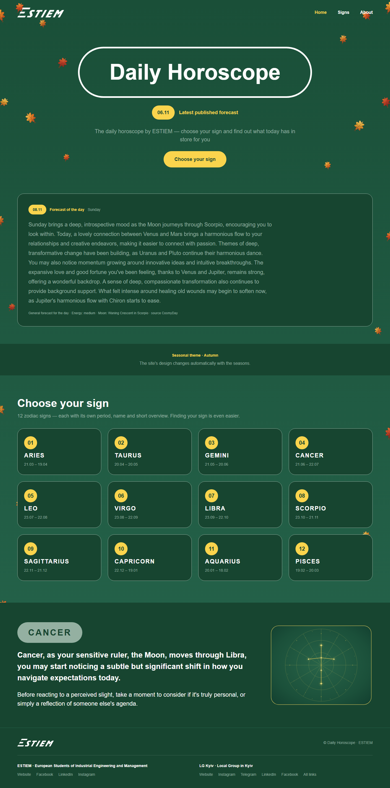

# ESTIEM Daily Horoscope

**The official horoscope of ESTIEM** — live: https://estiem-horoscope.netlify.app



The official ESTIEM horoscope: an English-language daily horoscope site —
home, all 12 zodiac signs, per-sign readings and an about page. Readings are
synced every day from the free
[CosmyDay](https://api.cosmyday.com) API into PostgreSQL and served through
public JSON actions: visitors never sign in. The design changes its seasonal
theme automatically — there is deliberately no season control in the UI.

## Highlights

- **Never a stale date.** A GitHub Actions cron refreshes content daily
  (03:30 UTC), and a read-time *self-heal* pulls the source — throttled to one
  attempt per 5 minutes per server instance — whenever today's rows are
  missing, so a delayed or failed cron run is invisible to visitors.
- **Public reads, protected writes.** The two GET actions answer without a
  session; `sync-horoscope` refuses to write unless the request carries the
  `HOROSCOPE_SYNC_TOKEN` value.
- **SSR at the edge.** React Router 8 server rendering on Netlify, PostgreSQL
  on Neon (Frankfurt), migrations applied automatically on production deploys.

## Tech stack

| Area | Choice |
| --- | --- |
| Frontend | React 19, React Router 8 (SSR/Nitro), Tailwind CSS 4, TanStack Query |
| API | Agent-Native actions — `GET/POST /_agent-native/actions/:name` |
| Database | PostgreSQL (Neon), Drizzle ORM, `horoscopes` unique on `(sign, date)` |
| Hosting | Netlify (`netlify.toml` → `scripts/netlify-build.mjs`) |
| Sync | GitHub Actions `cron: "30 3 * * *"` → `sync-horoscope` |
| Source | CosmyDay API (free, no API key) |

## API

| Action | Method | Who can call it | What it does |
| --- | --- | --- | --- |
| `get-today-horoscope` | GET | Public (no session) | Today's reading for all 12 signs (Europe/Kyiv); falls back to the latest stored day with `isFallback: true` |
| `get-sign-horoscope` | GET | Public (no session) | One sign by slug (`aries`…`pisces`), optional `date` |
| `get-day-forecast` | GET | Public (no session) | General (not per-sign) forecast for a day from the source's week-ahead batch; keeps the home page current even while the per-sign daily batch is unpublished |
| `sync-horoscope` | POST | Anyone; overwriting requires `HOROSCOPE_SYNC_TOKEN` env + matching `token` argument | Fetches the source and upserts all 12 rows |

```bash
# read today
curl 'https://estiem-horoscope.netlify.app/_agent-native/actions/get-today-horoscope'
# read one sign for a date
curl 'https://estiem-horoscope.netlify.app/_agent-native/actions/get-sign-horoscope?sign=cancer&date=2026-11-05'
# read the general forecast for a day
curl 'https://estiem-horoscope.netlify.app/_agent-native/actions/get-day-forecast'
# refresh content (cron)
curl -X POST 'https://estiem-horoscope.netlify.app/_agent-native/actions/sync-horoscope' \
  -H 'Content-Type: application/json' \
  -d '{"token":"<HOROSCOPE_SYNC_TOKEN>"}'
```

All four declare `requiresAuth: false`. Public *pages* are configured twice,
on purpose — the server list (`workspaceAppPublicPaths` in
`server/plugins/auth.ts`) and the client session gate (`PUBLIC_PATHS` in
`app/root.tsx`) must match, or signed-out visitors get bounced to `/sign-in`.

## Daily sync

CosmyDay regenerates around 03:03 UTC (Kyiv morning); the workflow in
`.github/workflows/horoscope-sync.yml` fires at 03:30 UTC and needs two
repository secrets: `SITE_URL` and `HOROSCOPE_SYNC_TOKEN`. The read-time
self-heal in `server/lib/horoscope-sync.ts` covers any gap the cron leaves —
it also refuses to write while the source has not published the current Kyiv
day yet, so old content is never labelled as today.

## Local development

```bash
cp .env.example .env
corepack enable
pnpm install
pnpm dev          # http://localhost:8080
pnpm test         # vitest
pnpm typecheck
pnpm agent-native:doctor
```

The local database is PGlite at `data/pglite` (no setup needed); production
needs a `DATABASE_URL`. `.env.example` documents `HOROSCOPE_SYNC_TOKEN` and
`BETTER_AUTH_*`; leave the sync token unset in dev so writes stay open.

## Deploying

Production is Netlify + Neon. Required environment variables:

| Variable | Purpose |
| --- | --- |
| `DATABASE_URL` | Neon Postgres connection string (pooled) |
| `BETTER_AUTH_SECRET` | Session signing secret |
| `BETTER_AUTH_TRUSTED_ORIGINS` | `https://<your-site>.netlify.app` |
| `HOROSCOPE_SYNC_TOKEN` | Shared secret for the sync action |

`netlify.toml` builds with `node scripts/netlify-build.mjs`; on production
context it also runs `pnpm migrate:production`, which applies Drizzle and
framework migrations before the deploy goes live.

## Project layout

- `app/` — routes and UI components (`routes/_index.tsx`, `routes/signs.$slug.tsx`, …)
- `actions/` — the three public endpoints plus the framework's agent actions
- `server/lib/horoscope.ts` — source fetch, parser, deterministic lucky extras
- `server/lib/horoscope-sync.ts` — shared upsert + read-time self-heal
- `server/plugins/` — auth (public paths), config, chat, branding
- `drizzle/` — schema and migrations; start with `drizzle/START_HERE.md`
- `docs/screenshot-home.png` — screenshot used above

## Credits

Horoscope content courtesy of [CosmyDay](https://cosmyday.com) (free astrology
API); one row per sign per day, synced daily.
